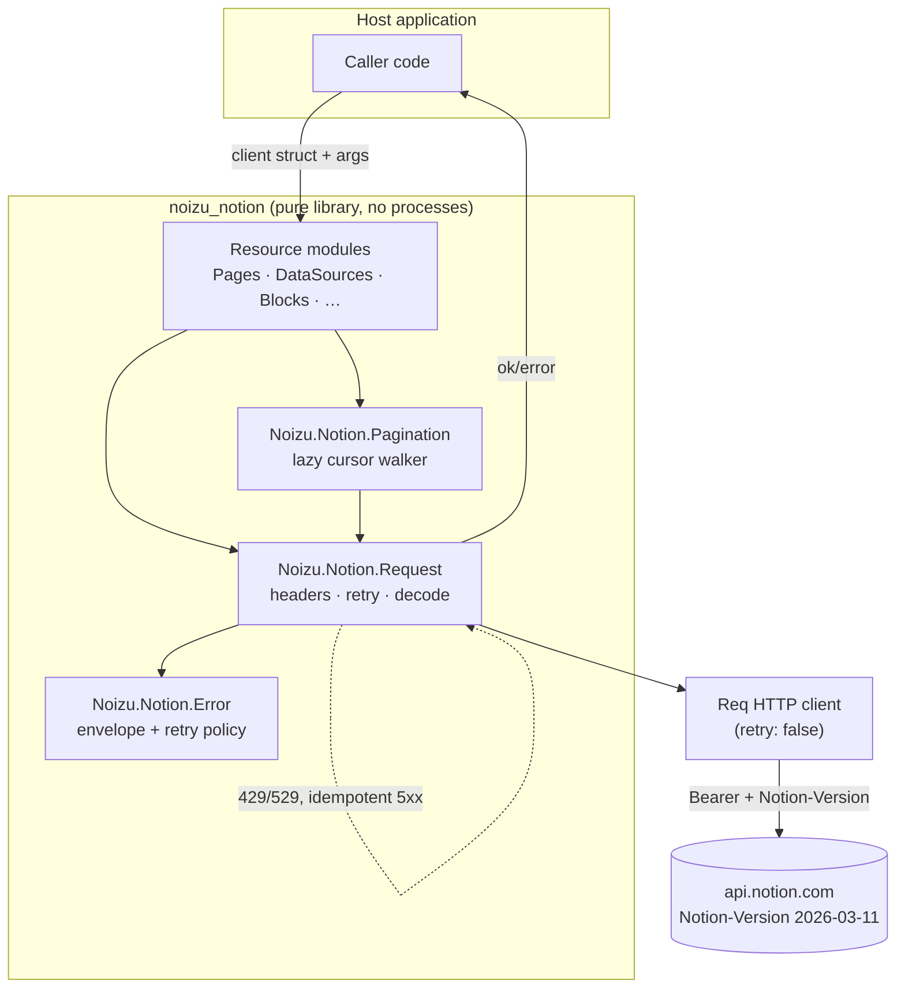

# Noizu.Notion — Architecture

〚📁:𔒾𔍀𔈩𓢿〛 noizu_notion architecture overview :: Architecture: layers, request lifecycle, error model, pagination, key decisions, stack.

## Overview

`noizu_notion` is a stateless Elixir client library for the Notion API, pinned to
`Notion-Version: 2026-03-11`. There is no supervision tree, no GenServer, no ETS, and no
global state: a caller builds a `%Noizu.Notion.Client{}` struct (bearer token + options)
and passes it explicitly as the first argument to every call. Every public function
returns `{:ok, map}` or `{:error, %Noizu.Notion.Error{}}` — no bang variants, no raising
on HTTP errors (streams are the one exception: a failed page fetch raises mid-enumeration,
because an `Enumerable` cannot return an error value).

The library is **contract-first**: `docs/API-CONTRACT.md` is the source of truth for the
wire behavior (endpoints, error taxonomy, retry, rate limits), and implementation, tests,
and future changes are reviewed against it. Responses stay raw maps (tolerant reader —
unknown fields are preserved and ignored, per Notion's own versioning guidance).

## System Diagram

〚📐:𔂼𓳞𓽭𓽗〛 noizu_notion system diagram :: Mermaid system diagram: host app, resource modules, request engine, Req, api.notion.com.

〚/📐:𔂼𓳞𓽭𓽗〛

## Core Components

| Component | Purpose |
|---|---|
| `Noizu.Notion` | Facade — `new/1` delegate, moduledoc quickstart. |
| `Noizu.Notion.Client` | Explicit connection struct: `token`, `version`, `base_url`, `req_options`, `retry`. Merges opts → app env → defaults. |
| `Noizu.Notion.Request` | Internal engine: builds the Req call, applies the bounded retry policy, normalizes every failure to `%Error{}`. |
| `Noizu.Notion.Error` | Error envelope as a `defexception`; known-code atom table; `retryable?/2` and `retry_after_ms/2` predicates. |
| `Noizu.Notion.Pagination` | `Stream.resource/3` cursor walker behind every `*_stream` helper. |
| Resource modules (8) | One module per Notion object: Pages, Databases, DataSources, Blocks, Users, Search, Comments, FileUploads. |

→ *Components ↔ directories: see [PROJ-LAYOUT.md](PROJ-LAYOUT.md) and
[layout/lib.md](layout/lib.md)*

## Request Lifecycle

One synchronous call per API request: token check → header build → Req request → decode →
retry loop (bounded, `Retry-After`-aware) → `{:ok, map}` / `{:error, %Error{}}`. Req's
built-in retry is hard-disabled (`retry: false`) so this library's policy is the single
owner of the retry wheel. Transport exceptions are wrapped as
`%Error{status: nil, code: :request_failed}` and are **not** retried.

→ *See [arch/request-lifecycle.md](arch/request-lifecycle.md) for the step-by-step flow
and retry state machine*

## Error Model

`%Noizu.Notion.Error{status, code, message, request_id, additional_data}` mirrors the
Notion error envelope. Documented codes are compile-time atoms (`known_codes/0`);
network-supplied codes are matched with `String.to_existing_atom/1` and membership-checked,
so unlisted codes stay strings — the library never creates atoms from network data.
Retry classification: 429/529 always; 502/503/504 only for idempotent methods
(`GET`/`HEAD`/`DELETE`); everything else (incl. `409 conflict_error` and `500`) returns
to the caller untouched.

→ *Full status → code map and rate-limit behavior: [API-CONTRACT.md §6](API-CONTRACT.md)*

## Pagination Design

`*_stream/2..4` helpers wrap `Pagination.stream/2`: a lazy `Stream.resource/3` that
fetches the next page only when the consumer pulls, emits one element per `results`
entry, and stops on `has_more: false` or a missing cursor. Cursors flow back as
`start_cursor` — query string on GET endpoints, JSON body on POST endpoints
(`with_cursor/2` vs `with_cursor_in_body/2`). Known sharp edge: the data-source query
cap (10 000 results) ends a stream silently; detecting truncation requires inspecting
the raw `query/3` envelope (`request_status`).

→ *Envelope shapes and the templates-endpoint quirk: [API-CONTRACT.md §5](API-CONTRACT.md)*

## Key Decisions

- **Explicit dependency-injected client, no globals** — testability (`Req.Test` plug
  injection via `req_options`), multi-token/multi-workspace use, no application-callback
  required. The `:noizu_notion, :client` app env is a read-at-call-time convenience only.
- **Raw maps, tolerant reader** — Notion adds fields additively across versions; strict
  structs would break on every additive change. The library never validates response
  bodies beyond the error envelope.
- **No atoms from the network** — unknown error codes stay strings
  (`String.to_existing_atom/1` + membership check), preventing atom-table flooding from a
  hostile or changed server.
- **Library-owned bounded retry** — 429/529 honor `Retry-After` (header, then body
  `additional_data.retry_after`, else linear `base_backoff_ms * attempt`); 5xx retries
  only on idempotent methods because a 5xx'd write may have applied. `Req` retry is
  disabled to keep one policy owner.
- **`{:ok, _}` / `{:error, %Error{}}` everywhere** — callers pattern-match documented
  codes; streams raise only where an enumerable must.
- **`Req ~> 0.7` floor** — the file-upload send endpoint uses Req's `form_multipart`,
  which does not exist in 0.5/0.6.
- **Out of scope by design** — OAuth dance, webhooks, views API, admin API, legacy
  database endpoints, object hydration. See [API-CONTRACT.md §7](API-CONTRACT.md).

## Technology Stack

| Layer | Choice |
|---|---|
| Language | Elixir `~> 1.20`, no framework |
| HTTP | `Req ~> 0.7` (JSON + multipart) |
| JSON | `Jason ~> 1.4` (decode fallback + encode in tests) |
| Test | Mix test + `Req.Test` plugs + `Plug ~> 1.16` (test-only); no network, no real tokens |
| Docs | `ex_doc ~> 0.37` (dev-only) |
| Package | Hex `noizu_notion` v0.1.0, MIT |

## Security Posture

The library holds a bearer credential in the client struct and sends it on every
request; it performs no logging of its own, stores nothing to disk, and starts no
processes. Threat analysis (token leakage paths, multipart handling, supply chain):
[THREAT-MODEL.md](THREAT-MODEL.md).
