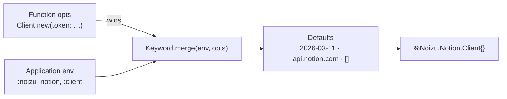
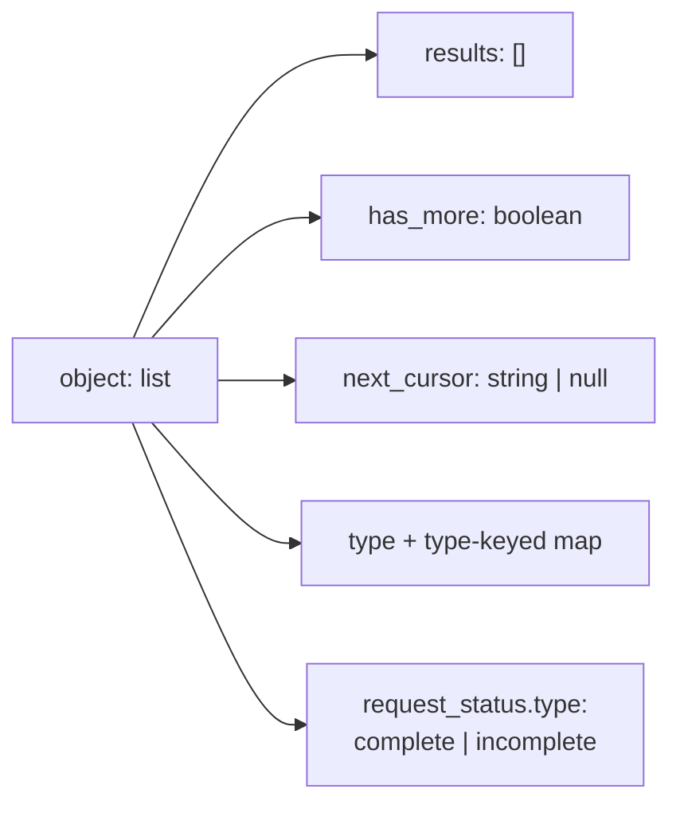

# Noizu.Notion — Data Schema Reference

`noizu_notion` has **no persistence layer**: no database, no Ecto schemas, no
Liquibase changelogs, no on-disk state, no cache or KV store. It is a stateless HTTP
client library, so the data model that actually matters here is the set of **structured
shapes it produces and accepts**: the client configuration schema, the Notion interface
envelopes it decodes, and the fixture shapes its tests assert against. That is what this
document covers; there is deliberately no ERD section.

Sources of truth, in order: `lib/noizu/notion/*.ex` (behaviour),
`docs/API-CONTRACT.md` (wire contract), `test/support/testing.ex` (fixture shapes).
Directory map: [PROJ-LAYOUT.md](PROJ-LAYOUT.md) → [layout/lib.md](layout/lib.md).

## Domains at a glance

| Domain | Kind | Where defined |
|---|---|---|
| Client config schema | Elixir struct + app env keyword list | `lib/noizu/notion/client.ex` |
| Retry config schema | Nested keyword list in `Client.retry` | `client.ex`, consumed in `request.ex` |
| Request shape | HTTP method · path · query params · JSON body · multipart form | `lib/noizu/notion/request.ex` |
| List envelope | Server JSON, paginated responses | `lib/noizu/notion/pagination.ex` |
| Error envelope | Server JSON → `%Noizu.Notion.Error{}` struct | `lib/noizu/notion/error.ex` |
| Fixtures | Test-only map builders | `test/support/testing.ex` |

## 1. Client configuration schema

`%Noizu.Notion.Client{}` is the only structured config the library owns. Fields are
merged `function opts → Application.get_env(:noizu_notion, :client) → defaults`
(`Keyword.merge/2`, function opts win).

### client

| Field | Type | Default | Description |
|---|---|---|---|
| `token` | `String.t() \| nil` | `nil` | Bearer credential (integration token, OAuth token, or PAT). May be nil at construction; required at request time — absent/empty fails fast with `401 unauthorized` before any network I/O. Redacted by the `Inspect` impl (T-001). |
| `version` | `String.t()` | `"2026-03-11"` | `Notion-Version` header value. `Client.api_version/0` returns the pinned default. |
| `base_url` | `String.t()` | `"https://api.notion.com"` | API root. Overriding it moves the bearer token to another host — treat config as secret-sensitive (T-008). |
| `req_options` | `keyword()` | `[]` | Merged into every `Req.request/1` (`plug:`, `receive_timeout:`, `user_agent:`). Library-owned keys (method, url, auth/version headers, `retry: false`) precede in the merged keyword, so they cannot be overridden (T-013). |
| `retry` | `keyword()` | `[]` | Nested retry config — see below. |

### retry (nested keyword)

| Key | Type | Default | Description |
|---|---|---|---|
| `:max_attempts` | `pos_integer()` | `3` | Total attempts; `0` disables retrying. |
| `:base_backoff_ms` | `non_neg_integer()` | `500` | Linear backoff when the server sends no usable `Retry-After` (`base * attempt`). |
| `:sleep_fn` | `(integer() -> any())` | `&Process.sleep/1` | Sleep escape hatch; tests observe delays without sleeping. |

Config layering — application env is a read-at-call-time convenience only; the library
never reads it anywhere else:

## 2. Request shape

Produced by `Noizu.Notion.Request.perform/4` — internal, but it defines the data the
library hands to Req.

| Element | Shape | Notes |
|---|---|---|
| Headers | `[{"authorization", "Bearer " <> token}, {"notion-version", version}]` ++ caller extras | Library headers are first; `req_options` cannot displace them. |
| Path | `String.t()` | Every interpolated ID passes `Request.encode_segment/1` (unreserved chars only) — T-012. |
| `:json` | JSON-encodable map | Mutually exclusive with `:form_multipart`. |
| `:form_multipart` | Req `form_multipart` keyword (fields + `{:file, path}`) | File-upload `send` only; `part_number` is sent as a string form field. |
| `:params` | `keyword()` | List values expand to repeated query keys (e.g. `filter_properties=a&filter_properties=b`). |
| Req core opts | `base_url`, `method`, `url`, `headers`, `retry: false` | Req's built-in retry is hard-disabled: this library owns retry. |

Pagination cursor flow (per endpoint class): `next_cursor` → next request's
`start_cursor`; **query string** on GET endpoints (`Pagination.with_cursor/2`), **JSON
body** on POST endpoints (`with_cursor_in_body/2`).

## 3. List envelope (paginated responses)

Consumed by `Pagination.stream/2`; key overridable via `results_key:` (templates uses
`"templates"`).

| Key | Type | Handling |
|---|---|---|
| `object` | `"list"` | Anything else that reaches the walker's feed is a shape failure: the message carries kind + size only, never content (T-005). |
| `results` | `[map()]` | One stream element per entry. |
| `has_more` | `boolean` | `false` ends the stream. |
| `next_cursor` | `String.t() \| nil` | Absent/null also ends the stream. Opaque — never parsed. |
| `request_status.type` | `"complete" \| "incomplete"` | Not consulted by the stream; data-source query cap (10 000) and `incomplete_reason: "query_result_limit_reached"` are only visible in the raw `query/3` envelope. |

Templates quirk: `GET /v1/data_sources/{id}/templates` returns results under
`"templates"`, not `"results"` (`results_key: "templates"`).

## 4. Error envelope

Server JSON → `%Noizu.Notion.Error{}` (a `defexception`, so it can be raised mid-stream).

### error envelope input (server)

| Key | Type | Notes |
|---|---|---|
| `object` | `"error"` | Required by `Error.from_response/2`; anything else yields `code: :invalid_response` with a shape-only message. |
| `status` | integer | Copied to the struct. |
| `code` | `String.t()` | Normalized to an atom **only** if it is in `known_codes/0` (20 documented codes); unknown codes stay strings — no atoms from network data (T-011). |
| `message` | `String.t()` | Copied verbatim. |
| `request_id` | `String.t()` | Copied; useful for support tickets. |
| `additional_data` | `map()` | Carries `retry_after` (clamped to 30 s, T-002) and `retry_guidance`. |

### error struct

| Field | Type | Nullable |
|---|---|---|
| `status` | `pos_integer()` | yes — `nil` for transport failures |
| `code` | `atom() \| String.t()` | yes — `:request_failed` / `:invalid_response` for library-detected failures |
| `message` | `String.t()` | yes |
| `request_id` | `String.t()` | yes |
| `additional_data` | `map()` | yes |

`retryable?/2`: `429`/`529` always; `502`/`503`/`504` only with `idempotent: true`
(`GET`/`HEAD`/`DELETE`); everything else false. `retry_after_ms/2` precedence: header
integer seconds → `additional_data.retry_after` → `nil`, clamped to `30_000` ms.

## 5. Fixtures (test-only data)

`Noizu.Notion.Testing` (compiled in `:test` only via `elixirc_paths/1`) — the canonical
shapes the suite asserts against; a real example of each envelope above.

| Helper | Shape |
|---|---|
| `client/2` | `Client` with `token: "test-token"` and a `plug:` Req.Test stub. |
| `list_page/2` | `%{"object" => "list", "results" => …, "has_more" => …, "next_cursor" => …}` plus a type keyed map (`type`, default `"page"`). |
| `error_body/3` | `%{"object" => "error", "status" => …, "code" => …, "message" => …, "request_id" => "req-abc-123"}`. |
| `body_params/1`, `query_params/1`, `header/2` | Request-side extractors for assertions. |
| `respond_json/3` | Plug response with JSON content type. |

## Schema-change checklist

- [ ] `Client` struct fields and defaults match `lib/noizu/notion/client.ex`.
- [ ] `known_codes/0` membership matches the table in `error.ex`.
- [ ] Envelope handling matches `pagination.ex` / `error.ex` behavior, not just the contract prose.
- [ ] Retry defaults (`3` attempts, `500` ms base, `30 s` clamp) match `request.ex` / `error.ex`.
- [ ] This file and `PROJ-SCHEMA.summary.md` agree.
