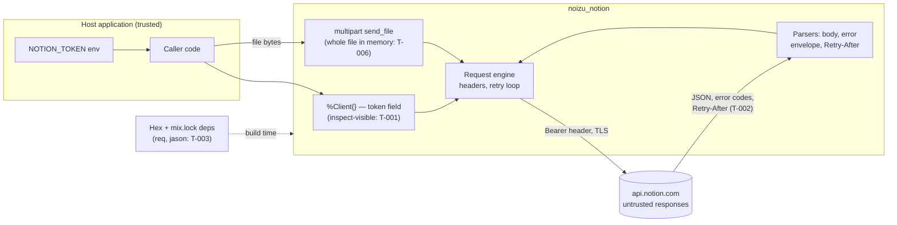

# Threat Model

〚📁:𓉇𓁀𓜂𓔪〛 noizu_notion threat model :: Threat model: token handling, untrusted input, retry DoS, uploads, Hex supply chain; vulnerability register.

Living threat model for `noizu_notion` — an Elixir client **library** (not a service).
The crown jewel is the **Notion bearer token** (internal integration token, OAuth token,
or personal access token) held in `%Noizu.Notion.Client{}`: whoever holds it gets every
capability the connection was granted, against every page in scope. Second-order asset:
the workspace content that flows through responses as raw maps.

## Scope and posture

The library starts no processes, opens no listeners, writes nothing to disk, and performs
no logging of its own. Its entire attack surface is: (1) how it holds and transmits the
token, (2) how it parses server-controlled responses, (3) its two runtime Hex
dependencies (`req ~> 0.7`, `jason ~> 1.4`), and (4) what it publishes to Hex for
downstream consumers. Threats that require control of the host process (env vars, app
env, memory) are the host application's threat model, not this one — the library treats
the host as trusted.

## Trust boundaries

```
Host app config (env vars, :noizu_notion app env)   ← trusted (host's problem)
        │  Client.new(token:, base_url:, req_options:)
        ▼
┌─────────────────────────────────────────────────────┐
│ noizu_notion library code (this threat model)       │
│   token in %Client{} · retry policy · JSON parsing  │
└─────────────────────────────────────────────────────┘
        │  HTTPS + Bearer (Req/Finch, TLS-verified)      ← boundary 1: egress
        ▼
   api.notion.com                                     ← untrusted peer after TLS
        │  JSON responses, error envelopes, Retry-After headers, cursors
        ▼
   response parsing (raw maps, atoms policy)          ← boundary 2: untrusted input
```

- **Boundary 1 (egress):** the token crosses in the `Authorization` header only; TLS
  verification is Req/Finch default (no opt-outs in the codebase).
- **Boundary 2 (ingress parse):** everything the server returns is untrusted data —
  bodies, error codes, `Retry-After` values, cursors — fed into maps, exceptions, and
  sleep durations.
- **Hex supply chain:** locked dependencies enter the host's build; the published Hex
  package enters every consumer's build.

→ *Per-boundary detail: [threats/token-handling.md](threats/token-handling.md),
[threats/request-and-retry.md](threats/request-and-retry.md),
[threats/file-uploads.md](threats/file-uploads.md),
[threats/supply-chain.md](threats/supply-chain.md)*

## Attack Surface



## Vulnerability Register

〚🧩:𓥰𓠙𔍟𓪸〛 noizu_notion vulnerability register :: Stable-ID vulnerability register (T-001..): severity, STRIDE, component, status; referenced from threats/*.md.

| ID | Severity | STRIDE | Component | Finding | Status |
|---|---|---|---|---|---|
| T-001 | High | Information disclosure | `Client` struct | `token` is a plain struct field with no redacted `Inspect` implementation — any `inspect/2`, crash-report, or `Logger.debug` that touches a client leaks the credential in plaintext logs | **Open** |
| T-002 | Medium | Denial of service | Retry loop | Server-controlled `Retry-After` (header or `additional_data`) is slept verbatim with `Process.sleep/1` — no upper clamp; a hostile/broken peer parks the calling process indefinitely (contract documents ≤60 s but the code does not enforce it) | **Open** |
| T-003 | Medium | Supply chain | Hex deps | Compromised `req`/`jason` release within `~>` bounds executes with host privileges and token access. Mitigations partial: `mix.lock` committed, tiny runtime dep tree; no automated audit (`mix hex.audit` / renovate) and **no CI at all** in this repo | **Partial** |
| T-004 | Low | Supply chain / Tampering | Repository | No CI pipeline exists (no `.github/`): nothing gates tests, formatting, or dependency audits on push/PR | **Open** |
| T-005 | Low | Information disclosure | Pagination errors | Malformed-envelope failures embed `inspect(other, limit: 5)` of the raw response into exception messages — workspace-content fragments can reach host logs | **Open** |
| T-006 | Low | Denial of service | `FileUploads.send_file/3` | File contents are passed as one binary: the whole file (multi-part mode targets >20 MiB, up to 10 000 parts) is buffered in caller memory; no streaming path | **Open** (documented) |
| T-007 | Low | Tampering | Retry + multipart | 429/529 retry applies to POST; a `send` that processed server-side but answered 529 could re-send a part. Consequence limited: same `part_number` overwrite, per-part idempotency | **Accepted** |
| T-008 | Medium | Information disclosure / EoP | `Client` options | `base_url` and `req_options` are host-controlled: config tampering (or a hostile default in `:noizu_notion, :client`) redirects the bearer token to an attacker's host. By design — the host is trusted; noted so consumers treat client config as secret-sensitive | **Accepted** |
| T-010 | — | Spoofing | Token transport | Token never appears in URLs or query strings — header only, so it stays out of proxy/access logs | Mitigated |
| T-011 | — | Tampering | Atom table | No atoms are created from network data: error codes go through `String.to_existing_atom/1` + `known_codes/0` membership; unlisted codes stay strings | Mitigated |
| T-012 | — | Tampering | Path building | Every ID interpolated into a URL path passes `Request.encode_segment/1` (percent-encoding, unreserved chars only) | Mitigated |
| T-013 | — | Tampering | Option precedence | `req_options` cannot override library-owned keys (`retry: false`, auth/version headers) — library options precede in the merged keyword, first occurrence wins | Mitigated |
| T-014 | — | Spoofing | Missing token | Absent/empty token fails fast (`{:error, 401 unauthorized}`) before any network I/O — no unauthenticated requests are ever sent | Mitigated |
| T-015 | — | Spoofing | Transport | TLS certificate verification is Req/Finch default; no `verify: false`, no plain-HTTP default (base URL is `https://api.notion.com`; a caller may still point `base_url` at plain HTTP deliberately — see T-008) | Mitigated |

〚/🧩:𓥰𓠙𔍟𓪸〛

## Mitigation Coverage

6 mitigated · 1 partial · 5 open · 2 accepted. The two highest-value fixes are small:
a redacted `Inspect` implementation for `%Client{}` (T-001) and a clamp on
`Retry-After`-derived sleep (T-002).

## Residual Risk

- **Host-process compromise is out of scope** (T-008): anything that can read env vars,
  app env, or process memory owns the token regardless of this library.
- **Server compromise / Notion-side incidents** out of scope: the library is a faithful
  transporter of whatever api.notion.com returns.
- **Retry-duplication ambiguity** (T-007): accepted — Notion's own guidance is that 429/529
  did not apply the write; per-part overwrite bounds the damage for uploads.
- **In-memory file buffering** (T-006): accepted for v0.1 — callers streaming huge files
  should chunk multi-part sends themselves.
