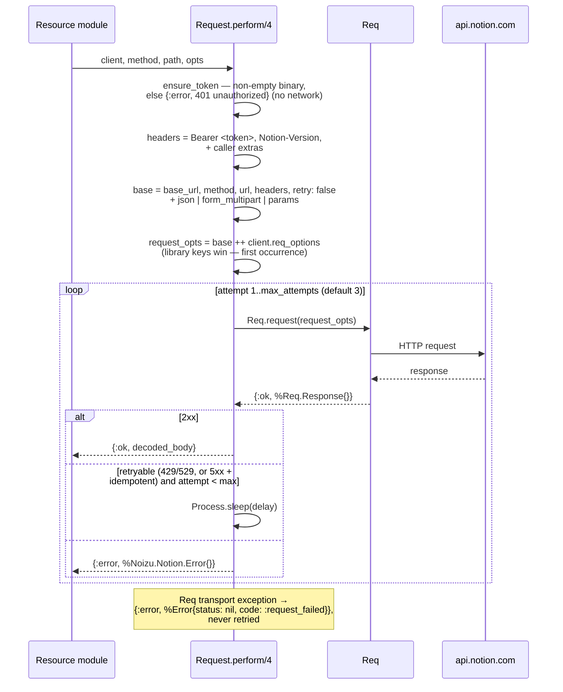

# Request Lifecycle — Detail

Step-by-step path of one `Noizu.Notion.Request.perform/4` call
(`lib/noizu/notion/request.ex`), and the retry state machine.

## Flow

〚📐:𓛺𔇱𔐷𓉐〛 request lifecycle sequence diagram :: Sequence diagram of Request.perform/4: token check, headers, Req call, decode, retry loop.

〚/📐:𓛺𔇱𔐷𓉐〛

## Steps

1. **Token check** — `ensure_token/1` requires a non-empty binary token; a missing token
   fails fast with `%Error{status: 401, code: :unauthorized}` without touching the network.
2. **Header build** — `authorization: Bearer <token>` and `notion-version: <client.version>`
   are always set by the library; caller-supplied `opts[:headers]` append after them.
3. **Option assembly** — `base` (method, url, headers, `retry: false`, body) then
   `request_opts = base ++ client.req_options`. Because keyword lookups take the first
   occurrence, library-owned keys (auth headers, retry) cannot be overridden by
   `req_options`; escape-hatch options like `plug:` or `receive_timeout:` merge in cleanly.
   Body is one of `:json`, `:form_multipart` (json checked first), or none.
4. **Query params** — `expand_params/1` turns a list value (`{:filter_properties, [a, b]}`)
   into repeated keys (`filter_properties=a&filter_properties=b`) — the documented form;
   asserted byte-exact by tests.
5. **Execute** — single `Req.request/1`. `retry: false` is load-bearing: Req's built-in
   retry must stay off so this policy owns the wheel.
6. **Decode** — 2xx: body stays a map, `""`/`nil` become `%{}`, a binary body gets one
   `Jason.decode` attempt, anything else passes through verbatim (tolerant reader).
7. **Classify** — non-2xx → `Error.from_response/2` (envelope-shaped bodies populate the
   struct; anything else → `code: :invalid_response`).
8. **Retry loop** — see below. Exhausted budget returns the last error.
9. **Transport failure** — `{:error, exception}` from `Req.request/1` is wrapped by
   `Error.from_exception/1` and returned immediately; connectivity errors are not retried.

〚🔀:𓴟𔎍𓷑𓣘〛 noizu_notion retry state machine :: Retry policy and Retry-After sourcing: 429/529 always, idempotent 5xx only, unbounded sleep caveat (T-002).

## Retry state machine

| Condition | Retry? | Delay |
|---|---|---|
| `429 rate_limited`, `529 service_overload` | always (any method) | `retry-after` header (integer seconds → ms) → body `additional_data.retry_after` → `base_backoff_ms * attempt` (linear, default 500 ms) |
| `502`, `503`, `504` | only idempotent methods (`GET`, `HEAD`, `DELETE`) | same budget, fixed short backoff (no `Retry-After` expected) |
| `409 conflict_error` | never — blind retries repeat the conflict | — |
| `500` | never (Notion: contact support; write may have applied) | — |
| transport exception | never | — |

- Budget: `client.retry[:max_attempts]`, default 3; `0` disables retrying entirely.
- Idempotency is decided by **method alone** (`method in [:get, :head, :delete]`); there is
  no per-call idempotency override.
- The retry sleeps in the calling process (`Process.sleep/1`) — callers on a LiveView or
  request process should size `max_attempts` accordingly.
- Writes that 5xx return the error untouched: per Notion, the change may already have
  applied, so automatic retries could duplicate it.

## Retry-After sourcing (`Error.retry_after_ms/2`)

1. `retry-after` response header, integer seconds, parsed with `Integer.parse/1`
   (negative/garbage falls through).
2. Body `additional_data.retry_after` (number → ms).
3. `nil` → caller backoff (`base_backoff_ms * attempt`).

〚/🔀:𓴟𔎍𓷑𓣘〛
